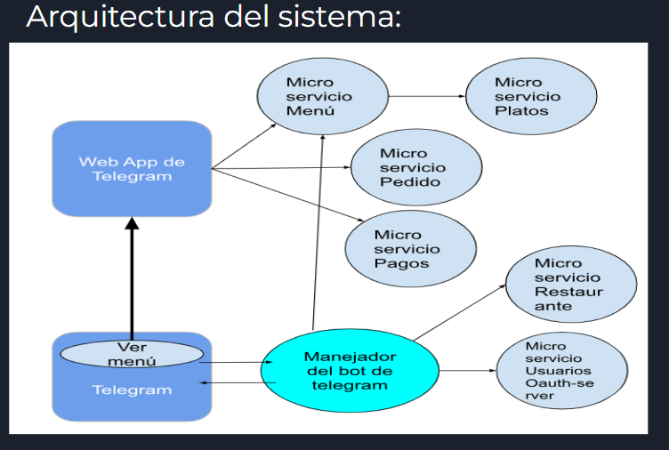
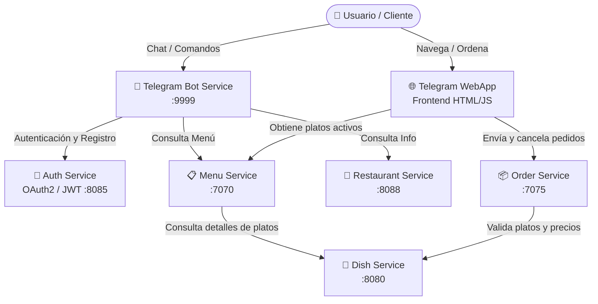
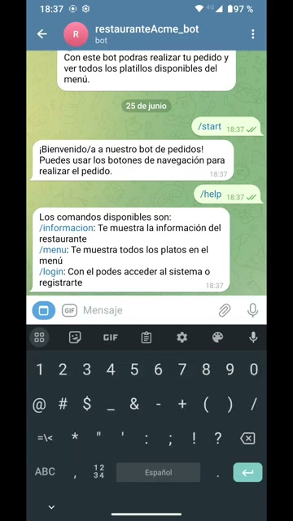
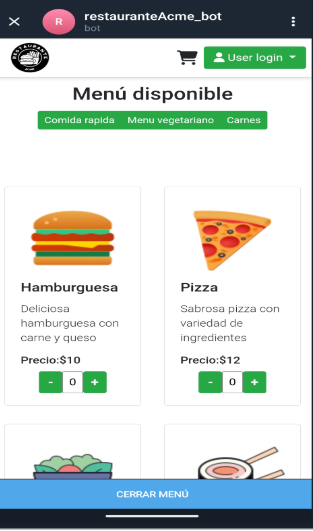
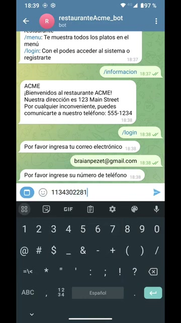
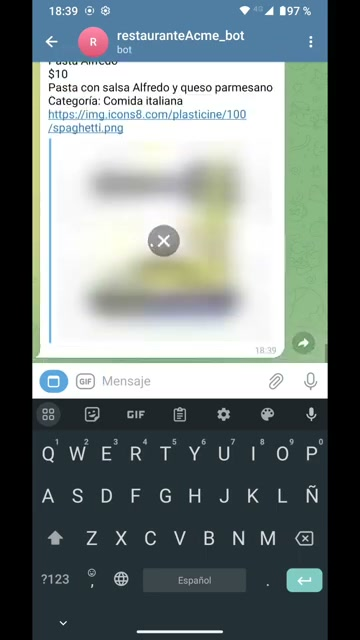

# 🍽️ Restaurante Sistema - Arquitectura de Microservicios

Sistema integral para gestión de restaurantes, menús y procesamiento de pedidos, implementado bajo una arquitectura orientada a microservicios con **Spring Boot** e integrado con un **Bot de Telegram** y una **Mini App (Telegram WebApp)** interactiva.

---

## 📌 Arquitectura del Sistema

El ecosistema está desacoplado en microservicios independientes que se comunican entre sí mediante REST APIs:

<div align="center">
  
  <p><i>Diagrama conceptual de la arquitectura del ecosistema de microservicios</i></p>
</div>



---

## 🎥 Demostración en Video

Haz clic en la imagen para ver el video completo del sistema y el flujo de pedidos en Telegram:

<div align="center">
  <a href="https://www.youtube.com/watch?v=qXQ3pUC9wgo" target="_blank">
    
  </a>
  <p><i>▶️ <a href="https://www.youtube.com/watch?v=qXQ3pUC9wgo">Ver video de la demo en YouTube (2m 46s)</a></i></p>
</div>

---

## 📸 Capturas del Sistema en Funcionamiento

<div align="center">
  <table>
    <tr>
      <td align="center"><b>1. Bot y Comandos en Telegram</b></td>
      <td align="center"><b>2. Catálogo en Telegram WebApp</b></td>
    </tr>
    <tr>
      <td align="center"></td>
      <td align="center"></td>
    </tr>
    <tr>
      <td align="center"><b>3. Selección interactiva de platos</b></td>
      <td align="center"><b>4. Resumen y Confirmación de Pedido</b></td>
    </tr>
    <tr>
      <td align="center"></td>
      <td align="center"></td>
    </tr>
  </table>
</div>

---

## 🚀 Microservicios y Componentes

| Módulo | Directorio | Puerto | Descripción |
| :--- | :--- | :--- | :--- |
| **Auth Service** | `services/auth-service` | `8085` | Servidor de autorización OAuth2 con generación y validación de tokens JWT. Maneja registro y login de usuarios. |
| **Dish Service** | `services/dish-service` | `8080` | Catálogo de platos del restaurante (CRUD, precios, imágenes, persistencia en H2 con carga inicial `data.sql`). |
| **Restaurant Service** | `services/restaurant-service` | `8088` | Gestión de datos del restaurante (nombre, dirección, presentación, teléfono y horarios). |
| **Menu Service** | `services/menu-service` | `7070` | Administración de menús. Agrupa platos de un restaurante consumiendo el catálogo de `dish-service`. |
| **Order Service** | `services/order-service` | `7075` | Procesamiento y seguimiento del ciclo de vida del pedido (cálculo de totales, detalle de platos y estados). |
| **Telegram Bot** | `services/telegram-bot` | `9999` | Bot de Telegram (Long Polling) que asiste al usuario, autentica cuentas y brinda acceso a la WebApp. |
| **Telegram WebApp** | `frontend/telegram-web-app` | Static | Mini App web (HTML5, Bootstrap, jQuery, SweetAlert2) para visualización de catálogo interactivo y checkout. |

---

## 🛠️ Tecnologías Utilizadas

- **Lenguajes & Frameworks:** Java 17+, Spring Boot (2.7.x / 3.1.x), Spring Security OAuth2, Spring Data JPA.
- **Seguridad:** Tokens JWT (JSON Web Tokens), BCrypt Password Hashing.
- **Bases de Datos:** In-Memory H2 Database con consolas web activas para desarrollo y testing rápido.
- **Documentación API:** Swagger / Springfox UI.
- **Integraciones:** Telegram Bot API (`telegrambots-spring-boot-starter`).
- **Frontend:** HTML5, CSS3, JavaScript (ES6), Bootstrap 5, jQuery, SweetAlert2.
- **Herramienta de Construcción:** Maven (Multi-módulo / Aggregator POM).

---

## ⚙️ Configuración y Ejecución

### 1. Prerrequisitos
- **Java JDK 17 o superior** instalado y configurado en el `PATH`.
- **Apache Maven 3.8+** instalado.
- (Opcional) Un token de bot creado con [@BotFather](https://t.me/BotFather) en Telegram.

### 2. Compilar todo el ecosistema
Desde la raíz del repositorio, ejecuta:
```bash
mvn clean compile
```
O para generar los empaquetados `.jar`:
```bash
mvn clean package -DskipTests
```

### 3. Configurar el Bot de Telegram
En `services/telegram-bot/src/main/resources/application.properties`, puedes definir tu token o pasarlo por variable de entorno:
```properties
telegram.bot.username=${TELEGRAM_BOT_USERNAME:restauranteAcme_bot}
telegram.bot.token=${TELEGRAM_BOT_TOKEN:TU_TOKEN_DE_TELEGRAM_AQUI}
```

### 4. Iniciar los Microservicios
Puedes levantar cada servicio desde su directorio correspondiente o usando Maven:

```bash
# 1. Auth Service
mvn -f services/auth-service/pom.xml spring-boot:run

# 2. Dish Service
mvn -f services/dish-service/pom.xml spring-boot:run

# 3. Restaurant Service
mvn -f services/restaurant-service/pom.xml spring-boot:run

# 4. Menu Service
mvn -f services/menu-service/pom.xml spring-boot:run

# 5. Order Service
mvn -f services/order-service/pom.xml spring-boot:run

# 6. Telegram Bot
mvn -f services/telegram-bot/pom.xml spring-boot:run
```

### 5. Frontend (Telegram WebApp)
Abre `frontend/telegram-web-app/index.html` en tu navegador o sírvelo con cualquier servidor estático (e.g. Live Server en VS Code o Nginx).
Los endpoints de los microservicios se encuentran centralizados al inicio de `frontend/telegram-web-app/js/index2.js` para fácil configuración:
```javascript
const API_CONFIG = {
    MENU_SERVICE_URL: 'http://localhost:7070',
    PEDIDO_SERVICE_URL: 'http://localhost:7075'
};
```

---

## 📖 Endpoints Principales y Documentación Swagger

Cada servicio expone su propia documentación interactiva de Swagger:
- **Dish Service Swagger:** `http://localhost:8080/swagger-ui.html`
- **Restaurant Service Swagger:** `http://localhost:8088/swagger-ui.html`
- **Menu Service Swagger:** `http://localhost:7070/swagger-ui.html`
- **Order Service Swagger:** `http://localhost:7075/swagger-ui.html`
- **Consola H2 (en cada servicio):** `http://localhost:<PUERTO>/h2-console` (JDBC URL: `jdbc:h2:mem:parcial`, Usuario: `user`, Clave: `user`).

---

## 🤖 Comandos Disponibles en Telegram

- `/start`: Mensaje de bienvenida al asistente.
- `/login`: Inicia el flujo interactivo de autenticación o solicitud de datos para registro automático en `auth-service`.
- `/informacion`: Obtiene la dirección, horarios y datos de contacto de `restaurant-service`.
- `/menu`: Consulta los platos activos disponibles en `menu-service`.
- `/help`: Lista de ayuda con todos los comandos disponibles.

---

## 👤 Autor

Desarrollado por [Braian Pezet](https://github.com/braianpezet).

